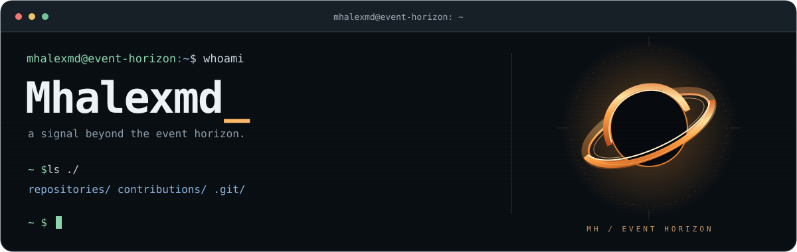

[Explore my repositories](https://github.com/Mhalexmd?tab=repositories) · [Start a conversation](https://github.com/Mhalexmd/Mhalexmd/issues)

## Contribution interceptor

One year of contributions. One pixel pilot. Every active day is a target.

The flight loops automatically. GitHub Actions refreshes the calendar every 6 hours; scheduled runs and image caching can delay updates. Hits only change this animation — your contributions stay intact.

Inside the cockpit

The calendar comes from GitHub's contribution API. Activity intensity sets the target color; the plane stops at each week, fires at active days, and clears the board before its next run. This animated SVG plays directly in a GitHub README without scripts or an external image service.

See [setup and local preview](SETUP.md).

END OF OUTPUT · THE NEXT COMMIT IS A NEW SIGNAL.

