<a href="https://github.com/Mhalexmd?tab=repositories"><picture>
  <source media="(prefers-reduced-motion: reduce)" srcset="https://raw.githubusercontent.com/Mhalexmd/Mhalexmd/master/assets/hangar.svg">
  
</picture></a>

<a href="https://raw.githubusercontent.com/Mhalexmd/Mhalexmd/master/assets/cinema-live.svg"><picture>
  <source media="(prefers-reduced-motion: reduce)" srcset="https://raw.githubusercontent.com/Mhalexmd/Mhalexmd/master/assets/cinema.svg">
  
</picture></a>

[Explore my repositories](https://github.com/Mhalexmd?tab=repositories) · [Start a conversation](https://github.com/Mhalexmd/Mhalexmd/issues)

## Contribution cinema

[Watch the original arcade flight](assets/plane.svg) | [Behind the animation](SETUP.md)

END OF OUTPUT · THE NEXT COMMIT IS A NEW SIGNAL.

